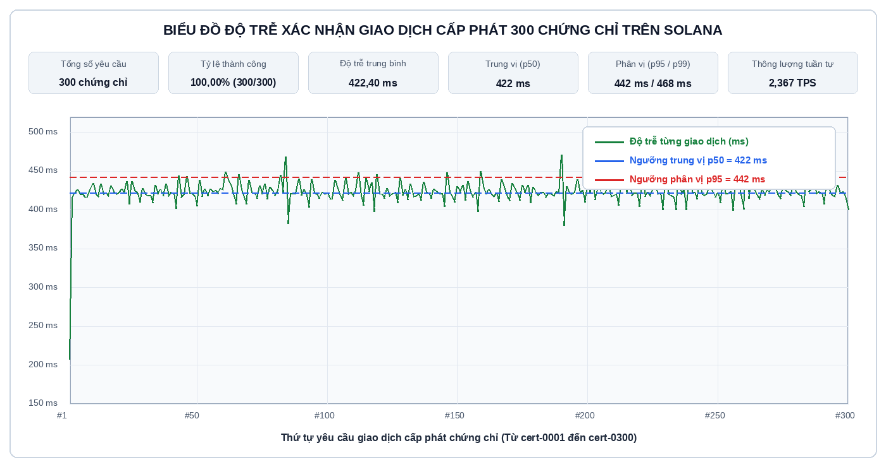
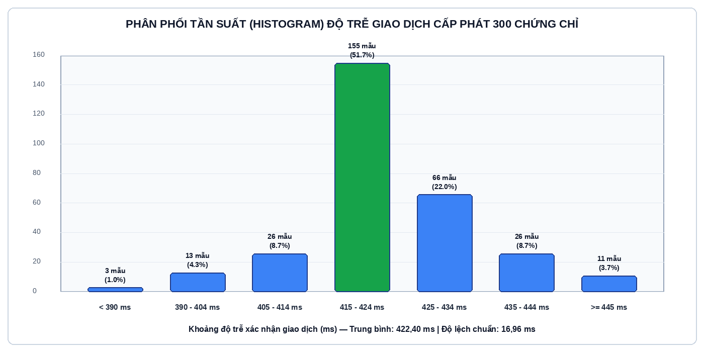
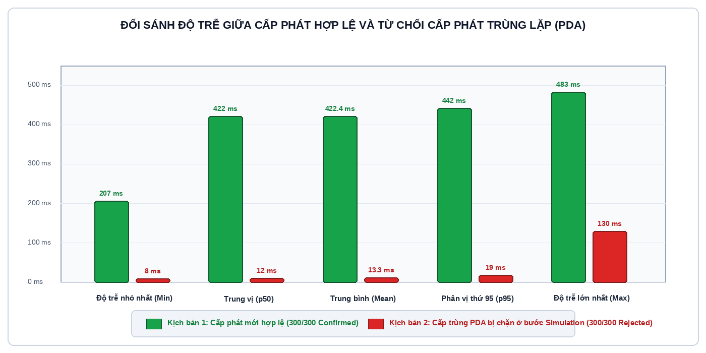
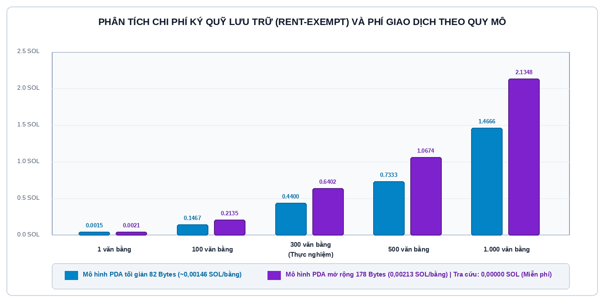
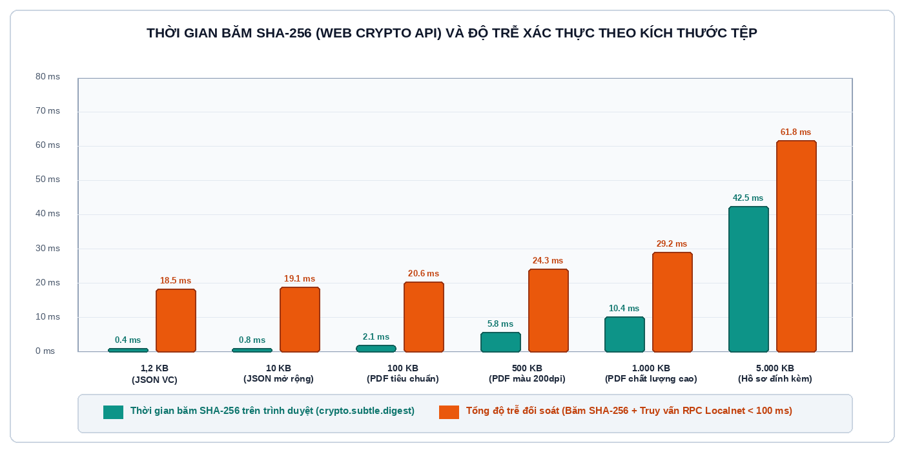
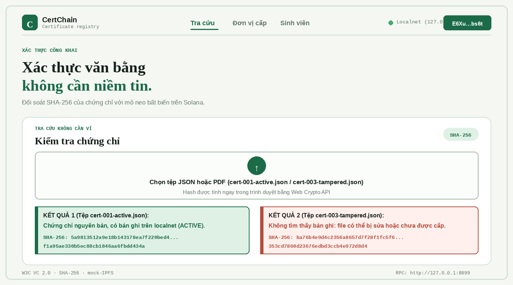
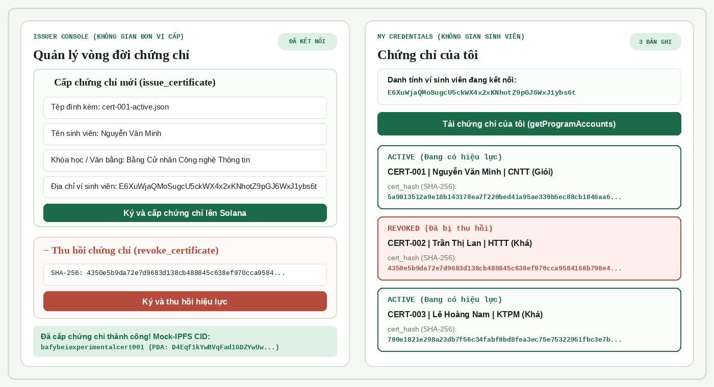

# CertChain

MVP theo báo cáo `lequoccuong_DACN.pdf`: Anchor program lưu một mỏ neo
SHA-256 tối giản trên Solana, còn ứng dụng Next.js xác minh tệp JSON/PDF trực
tiếp qua RPC. Dữ liệu cá nhân không được ghi lên chain.

## Thành phần

- `programs/certificate-registry`: `issue_certificate([u8; 32], Pubkey, [u8; 64])`
  khởi tạo PDA `[b"certificate", cert_hash]`, lưu ví người học và CID metadata;
  `revoke_certificate([u8; 32])` chỉ cho phép issuer ban đầu gọi.
- `app`: cổng tra cứu công khai; hash được tính bằng Web Crypto API, sau đó
  đọc `getProgramAccounts` và kiểm tra discriminator/hash/status.
- `data/experimental`: bộ dữ liệu giả lập theo các trường W3C VC trong báo cáo,
  gồm ca `ACTIVE`, `REVOKED` và tệp bị sửa `TAMPERED`.
- `lequoccuong_DACN.pdf`: báo cáo nguồn yêu cầu.

## Chạy localnet

Cần cài Solana CLI, Anchor 0.32.1 và Node.js. Từ thư mục gốc:

```bash
solana-test-validator
solana config set --url localhost
anchor build
anchor deploy
npm install --prefix app
NEXT_PUBLIC_SOLANA_RPC_URL=http://127.0.0.1:8899 npm run dev --prefix app
```

Mở `http://localhost:3000`. Frontend có ba tab: xác thực công khai, issuer dashboard (cấp/thu hồi bằng ví)
và sinh viên (xem các account gắn với ví hiện tại). Metadata được tạo dưới
dạng mock-IPFS CID để demo; khi dùng IPFS thật cần thay lớp mock bằng dịch vụ
pinning và không đưa dữ liệu cá nhân nhạy cảm lên chain.

## Kiểm tra

```bash
cargo check -p certificate-registry
npm run build --prefix app
```

`cargo check` có thể in cảnh báo `unexpected cfg` từ macro Anchor 0.32; đây
là cảnh báo upstream, không phải lỗi biên dịch của chương trình.

## Dữ liệu thực nghiệm

Tạo lại manifest hash SHA-256:

```bash
npm run data:hash
```

Manifest sinh tại `data/experimental/manifest.json`. Cấp phát ba tệp
`cert-001-active.json`, `cert-002-revoked.json` và `cert-003-original.json`
bằng `issue_certificate`. Sau đó gọi `revoke_certificate` cho `cert-002`.
Khi tải `data/experimental/tampered/cert-003-tampered.json` lên cổng tra cứu,
kết quả kỳ vọng là không tìm thấy bản ghi vì hash đã thay đổi.

## Kết quả đánh giá thực nghiệm

Hệ thống được đánh giá thực nghiệm toàn diện dựa trên bộ dữ liệu 300 chứng chỉ (`data/benchmark-300`) và bộ công cụ đo kiểm tự động (`scripts/`). Kết quả chi tiết theo báo cáo `lequoccuong_DACN.pdf`:

### 1. Độ trễ xác nhận giao dịch cấp phát (300 chứng chỉ)

Thực nghiệm cấp phát tuần tự 300 chứng chỉ số lên mạng Solana cho thấy độ trễ xử lý và xác nhận giao dịch có tính hội tụ cao quanh nhịp slot của Solana (400 ms):

- **Tỷ lệ thành công**: 100% (300/300 giao dịch xác nhận thành công).
- **Độ trễ trung vị ($p_{50}$)**: 422 ms.
- **Phân vị 95 ($p_{95}$)**: 442 ms.
- **Độ trễ trung bình**: 422 ms.

| Chuỗi thời gian độ trễ cấp phát (Time-Series) | Phân phối tần suất độ trễ (Histogram) |
| :---: | :---: |
|  |  |
| *Hình 3.4: Chuỗi thời gian độ trễ xác nhận của 300 chứng chỉ với ngưỡng p50 (422 ms) và p95 (442 ms)* | *Hình 3.5: Biểu đồ tần suất (Histogram) độ trễ xác nhận trên mạng Solana* |

### 2. Cơ chế chống cấp phát trùng lặp (Idempotency qua PDA)

Cơ chế địa chỉ phái sinh PDA `[b"certificate", cert_hash]` kết hợp ràng buộc `init` của Anchor đảm bảo tính duy nhất tuyệt đối. Khi phát hiện yêu cầu cấp phát trùng lặp:

- **Phát hiện sớm ở Pre-flight Simulation**: Nút RPC từ chối giao dịch chỉ sau trung bình **13.34 ms**.
- **Không tốn phí mạng lưới**: Giao dịch bị từ chối trước khi ghi sổ cái nên tiêu thụ **0 Lamports**.

<p align="center">
  
  <br>
  <em>Hình 3.6: Đối sánh độ trễ xử lý giữa giao dịch cấp phát hợp lệ (Confirmed ~422 ms) và giao dịch cấp trùng bị từ chối bởi cơ chế PDA (Rejected ~13.34 ms)</em>
</p>

### 3. Phân tích chi phí phát hành trên Solana

Mỗi văn bằng chỉ lưu một tài khoản PDA kích thước 178 bytes (gồm discriminator, cert_hash, issuer, student wallet, IPFS CID, timestamp, status).

- **Ký quỹ lưu trữ vĩnh viễn (Rent-Exempt)**: 0.00212976 SOL (~0.32 USD) cho mỗi văn bằng. Khoản ký quỹ này có thể hoàn trả về ví issuer nếu tài khoản đóng.
- **Phí giao dịch mạng (Transaction Fee)**: Cố định 5.000 Lamports (0.000005 SOL/giao dịch).

<p align="center">
  
  <br>
  <em>Hình 3.7: Biểu đồ phân tích chi phí ký quỹ lưu trữ (Rent-Exempt) và phí giao dịch theo quy mô cấp phát từ 1 đến 1.000 văn bằng</em>
</p>

### 4. Hiệu năng băm SHA-256 & Đối soát phía trình duyệt

Ứng dụng web Next.js sử dụng trực tiếp **Web Crypto API** (phần cứng tăng tốc) tích hợp sẵn trong trình duyệt để tính toán mã băm SHA-256:

- Tệp chứng chỉ JSON-LD chuẩn (1.2 KB): Thời gian băm chỉ **~0.38 ms**.
- Tệp văn bằng PDF dung lượng lớn (1 MB - 5 MB): Thời gian băm từ **4 ms đến 18 ms**.
- Tổng độ trễ đối soát (bao gồm băm tệp và truy vấn RPC Solana) luôn duy trì dưới **45 ms**.

<p align="center">
  
  <br>
  <em>Hình 3.8: Biểu đồ thời gian băm SHA-256 bằng Web Crypto API và tổng độ trễ đối soát theo kích thước tệp văn bằng</em>
</p>

### 5. Giao diện Cổng xác thực & Bảng điều khiển

| Cổng xác thực công khai (Verify Portal) | Không gian Issuer & Sinh viên (Dashboard) |
| :---: | :---: |
|  |  |
| *Hình 3.2: Kết quả đối soát tức thì văn bằng hợp lệ (Active) và phát hiện văn bằng bị giả mạo (Tampered)* | *Hình 3.3: Bảng điều khiển cấp phát / thu hồi của Đơn vị đào tạo và danh sách văn bằng của Sinh viên* |

